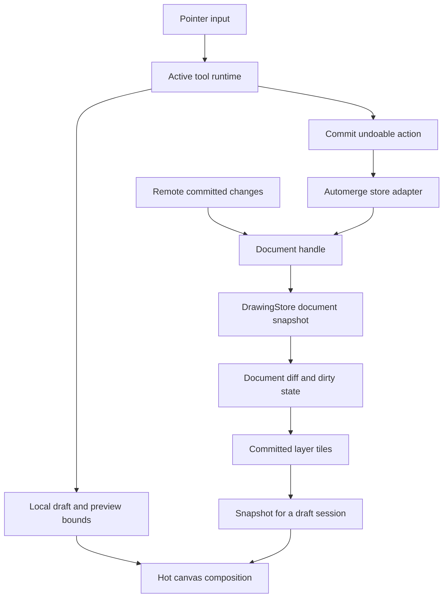

# Architecture overview

Splatterboard combines an Automerge drawing document with local interaction state and raster caches. Understanding which of those three owns a value is more useful than treating every visible change as a document mutation.

## Package boundaries

| Owner | Responsibility | Main entry points |
| --- | --- | --- |
| `core` | Document semantics, shape handlers, actions/undo, tool runtime, store and Automerge adapter | `packages/core/src/createSmalldraw.ts`, `store/drawingStore.ts`, `automerge/storeAdapter.ts` |
| `renderer-canvas` | Execute shape renderers and compose layers with correct isolation | `packages/renderer-canvas/src/shapes.ts`, `document.ts` |
| `renderer-raster` | Raster tiles, committed layer backends, frozen snapshot acquisition, hot composition | `packages/renderer-raster/src/index.ts`, `layerStack.ts`, `hotLayer.ts` |
| `splat` | Concrete drawing tools/shapes, application assembly, input, document lifecycle, renderer coordination | `packages/splat/src/app/createKidsDrawApp.ts`, `render/createRasterPipeline.ts` |
| `design-system` | Shared UI components and visual contracts | `packages/design-system/src/` |
| App hosts | Startup configuration, navigation and platform integration | `apps/splat-web`, `apps/splat-desktop`, `apps/app` |
| Server | Accounts, document access/metadata, thumbnails and Automerge storage/sync | `apps/server/src/` |

Concrete Splatterboard tools and their shape renderers live in `splat`. The renderer packages accept registries rather than importing those tools. The React account portal and re:dom editor share components/contracts, but are separate applications.

## Two update paths

Pointer movement normally changes a local draft, not the document. Pointer-up commits an action. The store adapter applies that action through the document handle; received remote edits also reach the store through handle changes. Undo history records local actions, not another participant's received operations.

The rendering pipeline consumes both document changes and draft changes. It does not render `document shapes + drafts` into one undifferentiated canvas. During drawing it displays a frozen scene plus the local draft; committed tiles can be updated behind it. At handoff it reveals the latest committed scene.

## State ownership

- The document contains size, presentation, layers and committed shapes. It is persisted and synchronized through Automerge-repo.
- Tool drafts, preview bounds, pointer sessions, local selection and UI state are transient. They do not become remote in-progress strokes.
- The catalog stores document-list metadata and local access/navigation information. A catalog key is not necessarily the Automerge identity used for sync.
- Tiles, snapshots, decoded image assets and cached paths are derived state. Their owners must release or invalidate them without changing document semantics.

See [the rendering pipeline](rendering-pipeline.md) for the canvas lifecycle, [cache ownership](rendering-cache-ownership.md) for derived data, and [multiplayer](multiplayer/index.md) for document identities.

## Invariants when changing boundaries

Keep document mutation in actions/store adapters, painting in renderers, and host navigation in app integration. Use explicit disposable subscriptions and narrow nanostore state where appropriate. A simplification that removes a canvas but changes erasing, remote visibility, or committed-stroke handoff is a behavioral change and needs evidence.
