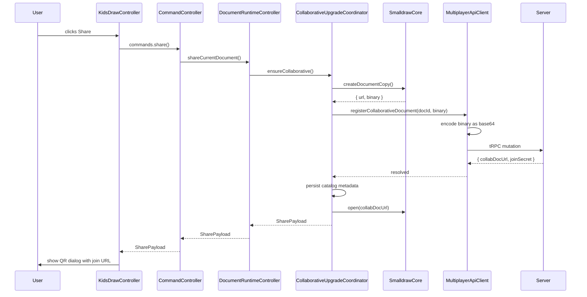

# Sharing: Upgrading a Local Document

When a user clicks "Share," a local document transforms into a collaborative one. This is a multi-step process involving a document copy, a server round-trip, metadata persistence, and a live switch to the new synced document. The collaborative upgrade coordinator orchestrates this.

## The App's Controller Layer

Before diving into the flow, a brief orientation on the controller hierarchy involved in sharing. The splat app has several controllers that form a chain:

- **KidsDrawController** — owns the top-level app UI, toolbar, and dialogs. Receives user intents (like "share") and delegates to the command controller.
- **CommandController** — handles command execution with loading states and error handling. Wraps each command in try/catch and pending-state management.
- **DocumentRuntimeController** — manages the lifecycle of the active document session. Owns the collaborative upgrade coordinator and applies timeouts to multiplayer operations.
- **CollaborativeUpgradeCoordinator** — the stateful orchestrator for the share flow itself.

These controllers are relevant to this page and the next. The document session controller (from [The Document Catalog](./02-document-catalog.md)) is a separate concern — it handles switching between documents, not sharing them.

## The Share Flow



## Step by Step

### 1. UI Intent

The share button publishes `{ type: "share" }` to the `uiIntentStore`. The intent controller routes this to the command controller's share handler.

### 2. Command Controller

`createKidsDrawCommandController.ts` wraps the share operation with:

- A request ID for deduplication (if the user double-taps)
- `setSharePending(true)` to show a loading state
- Error handling that surfaces the message to the user via `onShareError`
- A `finally` block that clears the pending state

### 3. Document Runtime Controller

`createDocumentRuntimeController.ts` wraps `ensureCollaborative()` in a 30-second timeout. If the server is unreachable or slow, the user sees: *"Share timed out while connecting to collaborative sync."*

### 4. Collaborative Upgrade Coordinator

This is where the real work happens (`createCollaborativeUpgradeCoordinator.ts`). It handles three cases:

**Already collaborative.** If the current document has `collaborative: true` and a `joinSecret`, return the existing share payload immediately. No server call needed — the document was already shared.

**Pending upgrade (recovery).** If a previous share attempt created a document copy but then failed (e.g., server was unreachable), the coordinator caches the copy and binary in memory. A retry reuses these rather than creating duplicates. This prevents orphaned documents on the server.

**New upgrade.** The happy path for a first-time share:

1. **Copy the document.** `core.createDocumentCopy()` creates a new Automerge document via `repo.create()`, then copies the current document's fields into it — `size` and `presentation` directly, `layers` and `shapes` via JSON round-trip (to strip Automerge proxy objects). Returns `{ url, binary }` — the new document's Automerge URL and its serialized binary.

2. **Register with the server.** The `MultiplayerApiClient` receives the document ID and binary `Uint8Array`, encodes the binary as base64, and sends it to the server via tRPC mutation. The server imports the binary into its own Automerge repo and creates a join secret (a random token).

3. **Persist metadata.** Update the catalog entry: set `collaborative: true`, store the `collabDocUrl` and `joinSecret`. This survives page reloads.

4. **Switch the core.** Call `core.open(collabDocUrl)` to switch the live editing session to the collaborative document. From this point on, changes sync to the server.

5. **Return the payload:**
   ```typescript
   interface SharePayload {
     catalogDocUrl: string;   // local catalog key
     collabDocUrl: string;    // Automerge-repo sync URL
     joinSecret: string;      // token for share links
     joinUrl: string;         // full URL: https://app.example.com/?join=<secret>
     upgraded: boolean;       // true if this was a new upgrade
   }
   ```

### 5. Show Dialog

The `KidsDrawController` receives the payload, generates a QR code from `joinUrl`, and displays a modal dialog with the QR code and a copyable URL.

## Why a Document Copy?

The original local document has a document ID that only the creator's browser knows about. The server needs to store the document under an ID it can manage and serve to joiners. Creating a copy with `repo.import()` on the server gives the document a stable identity in the server's repo.

After the copy, the original local-only document is effectively orphaned. The user's session switches to the collaborative copy. The catalog entry is updated to point to the new collaborative identity.

## The Join URL

```typescript
// packages/splat/src/documents/collaboration.ts
function buildJoinUrl(joinSecret: string, baseUrl: string): string {
  const url = new URL(baseUrl);
  url.searchParams.set("join", joinSecret);
  return url.toString();
}
```

The base URL is resolved from configuration, falling back to `window.location.origin`. The join secret is the only piece of information in the URL — the server maps it to the document.

## Error Handling

Errors at any stage propagate up to the command controller, which calls `onShareError(message)`. The UI shows the error message. Common failures:

- **Multiplayer not configured:** The document runtime controller's `createDocumentCopy` wrapper throws if the multiplayer API wasn't provided at app init.
- **Server unreachable:** The tRPC call fails, or the 30-second timeout fires.
- **Registration fails:** The server returns an error (e.g., document import fails).

Errors don't leave the app in a broken state. The upgrade coordinator's pending-state tracking means a retry will pick up where it left off if the copy was already created.
