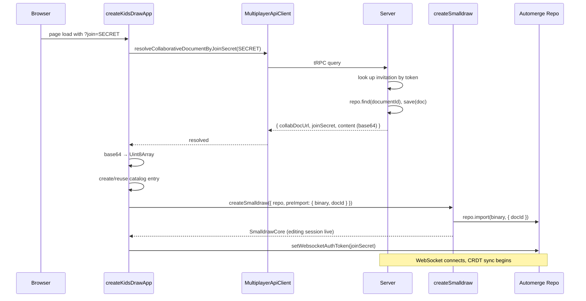

# Joining: Resolving a Share Link

When someone opens a share link like `https://app.example.com/?join=p0j2kmQtPV8u7p5I`, the app resolves the join secret, downloads the document binary, imports it locally, and starts syncing. This page traces that flow from the joiner's perspective.

## The Join Flow



## Step by Step

### 1. Extract the Join Secret

In the web app entry point (`apps/splat-web/src/main.ts`), the `?join=` query parameter is extracted and passed into the app options:

```typescript
multiplayer: {
  joinSecret: new URLSearchParams(window.location.search).get("join") ?? undefined,
}
```

### 2. Resolve with the Server

`createKidsDrawApp()` checks for a `joinSecret` in the multiplayer options. If present, it calls `multiplayerApiClient.resolveCollaborativeDocumentByJoinSecret(joinSecret)`.

The server looks up the join secret in its `documentInvitations` table, finds the associated document, serializes it with Automerge's `save()`, and returns:

```typescript
{
  collabDocUrl: "automerge:abc123",  // the document's Automerge URL
  joinSecret: "p0j2kmQtPV8u7p5I",   // same token (for persistence)
  content: "base64-encoded-binary"   // full Automerge document snapshot
}
```

If the secret doesn't match any invitation, the server returns `null`, and the app throws `"Invalid share link."`. If the document exists but can't be serialized (e.g., not loaded within 3 seconds), the server throws an error.

### 3. Import the Document Binary

The base64 content is decoded to a `Uint8Array` and passed to `createSmalldraw()` as the `preImport` option:

```typescript
preImport: {
  binary: joinedDocumentBinary,
  docId: documentIdFromCollabUrl,
}
```

During initialization, the core calls `repo.import(binary, { docId })` to load the document into the local Automerge-repo at the correct document identity. Both the binary and the document ID are required — without the ID, the document would be imported under a random new identity and wouldn't match the sharer's document. After import, the document is stored locally in IndexedDB and can be opened without the server.

The handle cache check in `createSmalldraw` (described in [Automerge as the Document Layer](./01-automerge-as-document-layer.md)) is relevant here: the pre-imported document is already in the repo's handle cache, so the subsequent `find()` step picks it up immediately without needing a network round-trip or timeout.

### 4. Create the Catalog Entry

The app checks whether a catalog entry for this `collabDocUrl` already exists (the user may have joined before). If not, it creates one:

```typescript
await documentBackend.createDocument({
  docUrl: buildJoinedCatalogDocUrl(resolved.collabDocUrl), // "catalog-collab:abc123"
  collaborative: true,
  collabDocUrl: resolved.collabDocUrl,
  joinSecret: resolved.joinSecret,
});
await documentBackend.setCurrentDocument(catalogDocUrl);
```

The catalog URL uses the `catalog-collab:` prefix to distinguish joined documents from locally-created ones (see [The Document Catalog](./02-document-catalog.md)).

### 5. Set Up WebSocket Authorization

After the core is initialized, the app configures the WebSocket connection for real-time sync:

```typescript
repo.setWebsocketAuthToken(joinSecret);
repo.setWebsocketAuthorizedDocumentId(documentId);
```

The join secret becomes the WebSocket authentication token. The server's upgrade handler validates it and scopes the connection to the specific document (covered in [Real-Time Sync](./06-realtime-sync.md)). The `websocketAuthorizedDocumentId` tells the announce policy to only send this one document to the server — preventing any local-only documents from leaking.

### 6. Sync Begins

With the WebSocket connected and authorized, Automerge-repo's sync protocol takes over. The client and server exchange sync messages to converge on the latest document state. Any changes made by the sharer since the snapshot was taken arrive as incremental updates.

## Deduplication

If the user clicks the same join link twice, the app detects the existing catalog entry by matching `collabDocUrl`:

```typescript
const existingSummary = existingSummaries.find(
  (summary) => summary.collabDocUrl === resolved.collabDocUrl,
);
```

If found, it reuses the existing catalog URL instead of creating a duplicate.

## Error Handling

Join errors propagate to the startup error boundary. The web app entry point catches failures from `createKidsDrawApp()` and renders a fallback UI showing:

- "Could not open drawing"
- "Startup failed. This should not leave a blank screen."
- The error message (e.g., "Invalid share link." or "Failed to serialize document")
- Retry and Reset buttons

This replaced an earlier design where join failures silently fell back to a blank canvas — a confusing experience where the user couldn't tell whether the join succeeded or not.

## The Binary Snapshot

The document binary the server sends is a complete Automerge snapshot, including change history. This matters for the CRDT: Automerge's sync protocol works by comparing histories and exchanging missing changes. By importing the full snapshot, the joiner establishes a common history with the sharer. This is what allows subsequent incremental sync to work — both peers share enough common ancestors to merge future changes correctly.

After import, the local repo has the document. Even if the WebSocket connection drops, the user can continue editing locally. Changes made offline will merge when the connection resumes, because both sides still share the same history base.
