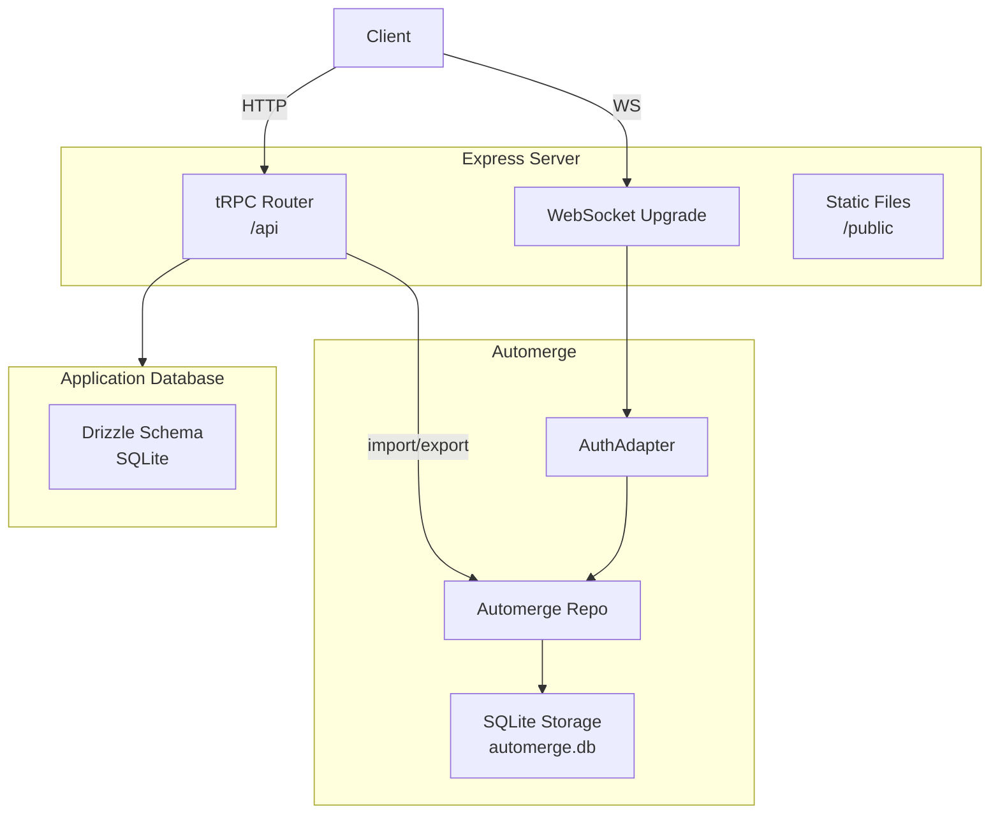

# The Server

The server (`apps/server/`) is an Express app that serves three purposes: a tRPC API for document management, an Automerge-repo for document storage and sync, and WebSocket termination for real-time collaboration. It runs on port 3030.

## Architecture



Like the client, the server has two independent storage systems. The application database (SQLite via Drizzle) stores relational data: documents, invitations, and access control metadata. The Automerge storage (a separate SQLite database via `SqliteStorageAdapter`) stores CRDT document data: snapshots and incremental changes. They share the document ID as a common key.

## The Automerge Repo

The server maintains its own Automerge repo (`apps/server/src/automergeRepo/automergeRepo.ts`):

```typescript
const repo = new Repo({
  network: [new AuthAdapter(webSocketServer)],
  storage: new SqliteStorageAdapter(dbPath),
  peerId: `storage-server-${hostname}`,
  sharePolicy: serverSharePolicy,
});
```

**Storage** is a custom `SqliteStorageAdapter` backed by a SQLite database (`automerge.db`). It implements Automerge-repo's `StorageAdapter` interface with a single `automerge_data` table (`key TEXT PRIMARY KEY, value BLOB`). Keys use `/` separators (e.g., `docid/snapshot`, `docid/changes/0`).

**Share policy** is conservative: the server only shares documents when a client requests a specific document ID. It returns `Boolean(documentId)` — true if a document ID is present, false otherwise. The server never proactively pushes documents to clients.

**Network** is a single `AuthAdapter` that wraps the WebSocket server. It intercepts every sync message for authorization checks before passing it to the repo. More on this in [Real-Time Sync](./06-realtime-sync.md).

## The tRPC Router

The router (`apps/server/src/trpc/appRouter.ts`) exposes procedures for document management. (tRPC is a TypeScript RPC framework that provides end-to-end type safety between client and server.) The anonymous collaboration procedures are what the current multiplayer feature uses.

### Anonymous Collaboration Procedures

These are public procedures (no session required):

**`registerCollaborativeDocument`** — Called by the sharer.
- Input: `{ documentId, content }` (content is base64-encoded Automerge binary)
- Decodes the binary via `Buffer.from(content, "base64")` and imports it into the server's repo via `repo.import(binary, { docId })`
- Creates a `documents` row and a `documentInvitations` row with a random token
- Returns `{ collabDocUrl, joinSecret }`

**`resolveAnonymousCollaborativeDocument`** — Called by the joiner.
- Input: `{ joinSecret }`
- Looks up the invitation by token
- Finds the document handle in the repo via `repo.find()`, serializes it with `save(doc)`, base64-encodes the result
- Returns `{ collabDocUrl, joinSecret, content }` (content is the base64-encoded binary)
- Returns `null` if the token is invalid
- Throws `INTERNAL_SERVER_ERROR` if the document exists but can't be serialized

The serialization has a 3-second timeout via `AbortController`. If the server's repo can't find/load the document in time, the joiner gets an explicit error rather than hanging.

### Authenticated Collaboration

The router also contains authenticated procedures for a future user-identity flow (user registration via OPAQUE, session management, per-user document access control, named collaborators). These use `protectedProcedure` which requires a session key in the `Authorization` header. They're not used by the current splat web app's multiplayer feature.

## Database Schema

The application database (`apps/server/src/db/schema.ts`) uses Drizzle ORM with SQLite. For anonymous collaboration, only two tables matter:

**`documents`** — Tracks known collaborative documents.
- `id` (text, PK): matches the Automerge document ID
- `name` (text, default "Untitled")
- `createdAt`, `updatedAt` timestamps

**`documentInvitations`** — Maps join secrets to documents.
- `id` (text, PK): random UUID
- `documentId` (FK → documents)
- `token` (text, unique): the join secret — generated via `crypto.randomBytes(16)`, base64url-encoded
- `createdAt` timestamp

One active invitation per document. `createOrRefreshDocumentInvitation` deletes the old one before creating a new one.

The schema also includes `users`, `sessions`, `usersOnDocuments`, and `loginAttempts` tables for the authenticated flow.

## Request Flow Summary

Pulling together the server's role in the two main multiplayer operations:

**Sharing (register):**
1. Client POST → tRPC `registerCollaborativeDocument`
2. Server decodes base64, calls `repo.import(binary, { docId })`
3. Server creates `documents` + `documentInvitations` rows
4. Server returns `{ collabDocUrl, joinSecret }`
5. Client uses joinSecret to build the share URL

**Joining (resolve):**
1. Client GET → tRPC `resolveAnonymousCollaborativeDocument({ joinSecret })`
2. Server looks up invitation → finds document ID
3. Server calls `repo.find(documentId)` → waits for handle → `save(doc)` → base64
4. Server returns `{ collabDocUrl, joinSecret, content }`
5. Client imports binary locally, opens WebSocket for live sync
