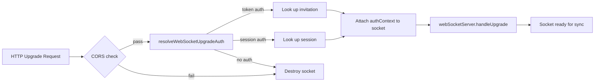

# Real-Time Sync and Authorization

Once a document is shared, both the sharer and joiner need to sync changes in real time. This is handled by Automerge-repo's sync protocol running over WebSockets, with a custom authorization layer that ensures clients can only access documents they're allowed to.

## The Sync Stack

```
┌─────────────────────────────┐
│  Drawing Store / Renderer   │  ← reacts to document changes
├─────────────────────────────┤
│  Automerge-repo             │  ← CRDT sync protocol
├─────────────────────────────┤
│  BrowserWebSocketClient     │  ← client-side network adapter
│  Adapter                    │
├─────────────────────────────┤
│  WebSocket (wss://)         │  ← transport
├─────────────────────────────┤
│  AuthAdapter                │  ← server-side message interceptor
├─────────────────────────────┤
│  Automerge-repo (server)    │  ← authoritative CRDT store
├─────────────────────────────┤
│  SqliteStorageAdapter       │  ← persistent storage
└─────────────────────────────┘
```

Automerge-repo handles the CRDT sync automatically. The app doesn't send or receive sync messages directly. It creates documents, mutates them through handles, and the repo synchronizes changes with connected peers. The interesting parts are how connections are established, authorized, and scoped.

## WebSocket Connection Lifecycle

### Client Side

The client creates a `BrowserWebSocketClientAdapter` in `createLocalSmalldrawRepo.ts`. The WebSocket URL includes the auth token as a query parameter:

```typescript
// simplified from buildServerWebsocketUrl()
const url = new URL(websocketUrl);
url.searchParams.set("token", authToken);
const wsAdapter = new BrowserWebSocketClientAdapter(url.toString());
```

The adapter is added to the repo's network subsystem dynamically — not at repo creation time. This allows the app to defer the WebSocket connection until it knows which document to sync and has a valid token.

Connection state is tracked via adapter events:
- `peer-candidate` → mark connected, publish state change
- `peer-disconnected` → mark disconnected
- `close` → force disconnected

The collaboration status store subscribes to these state changes and shows "Collab drawing (online)" or "Collab drawing (offline)" in the toolbar.

**Token updates:** If the auth token changes, the old WebSocket adapter is removed and a new one is created with the updated token. `setWebsocketAuthToken()` handles this, skipping the adapter reset if the token hasn't actually changed.

### Server Side

The server handles WebSocket upgrades in `apps/server/src/index.ts`:



`resolveWebSocketUpgradeAuth()` (`apps/server/src/wsUpgradeAuth.ts`) extracts credentials from the URL query parameters:

- `?token=<joinSecret>` → look up `documentInvitations` → auth context: `{ kind: "token", documentId }`
- `?sessionKey=<key>` → look up `sessions` → auth context: `{ kind: "session", userId }`

If both are present, token takes precedence. The auth context is attached to the raw socket object before Automerge-repo sees it.

## The Auth Adapter

The `AuthAdapter` (`apps/server/src/automergeRepo/authAdapter.ts`) is the authorization enforcement layer. It extends Automerge-repo's `NodeWSServerAdapter` and intercepts every incoming CBOR-encoded message before it reaches the repo.

### Message Authorization

For each message that contains a `documentId` field:

**Token-scoped auth:** The message's `documentId` must match the token's `documentId`. A client authenticated with a join secret can only sync the document that secret was created for. This prevents a malicious client from using a valid token to access other documents on the server.

**Session-scoped auth:** The adapter checks `getUserHasAccessToDocument(userId, documentId)` — a database lookup against the `usersOnDocuments` table. The user must have been granted access (either as admin/creator or via `acceptDocumentInvitation`).

Messages without a `documentId` (e.g., protocol-level handshakes) pass through without authorization checks. If authorization fails for a message with a `documentId`, the message is silently dropped and logged.

### Ephemeral Messages

Automerge-repo supports ephemeral messages for features like cursor presence. The auth adapter validates these separately when they carry a `documentId`:

- The ephemeral payload must have `type: "awareness"`
- For session auth: the `userId` in the awareness payload must match the authenticated `userId` (prevents spoofing another user's presence)
- For token auth: awareness is allowed without a userId check (anonymous users don't have user IDs)

## Announce Policies

Announce policies control which documents a repo tells each peer about. They're critical for preventing accidental data leaks.

### Server

```typescript
// apps/server/src/automergeRepo/automergeRepo.ts
async function serverSharePolicy(_peerId: string, documentId?: string): Promise<boolean> {
  return Boolean(documentId);
}
```

The server only shares documents when a client requests a specific document ID. It never announces documents proactively. A client can't discover documents by connecting — it must already know the document ID (from the join flow).

### Client

The client's announce policy (`packages/splat/src/documents/repoSharePolicy.ts` + inline in `createLocalSmalldrawRepo.ts`) is more nuanced and operates in two modes:

**Token-scoped mode** (anonymous/join flow): When `websocketAuthorizedDocumentId` is set, only that specific document ID is announced to the server. Everything else is blocked. This is the default for joiners — they have a token scoped to one document, and the announce policy enforces that boundary on the client side too.

**Index-based mode** (authenticated flow): When no scoped authorization is active, the policy delegates to the `CollaborativeDocumentIndex` (from [The Document Catalog](./02-document-catalog.md)) to check whether a document is collaborative. Only collaborative documents are announced.

In both modes, the `BroadcastChannelNetworkAdapter` (cross-tab sync) is not subject to the server announce policy. All documents sync freely across tabs in the same browser — only server-bound traffic is filtered.

## How Sync Actually Works

Once the WebSocket is connected and authorized, Automerge-repo's binary sync protocol handles the rest:

1. **Handshake:** Client and server exchange sync states — compact summaries of which changes each side has.

2. **Diff exchange:** Each side sends changes the other is missing. These are CRDT operations, not document snapshots — they're small and incremental.

3. **Merge:** Each side applies received changes to its local copy. Automerge's CRDT guarantees that both sides converge to the same state regardless of the order changes arrive.

4. **Steady state:** After initial sync, changes flow immediately as they happen. A brush stroke on one client appears on the other within a network round-trip.

The app doesn't manage any of this directly. It creates shapes through the store adapter (`handle.change()`), and the repo syncs automatically. On the receiving side, the handle emits a `"change"` event, which the store adapter forwards to the drawing store, which diffs and re-renders. This is the same path described in [Automerge as the Document Layer](./01-automerge-as-document-layer.md) — remote changes flow through the identical code path as local ones.

## Offline and Reconnection

Because Automerge-repo persists to IndexedDB on the client, the app works offline:

- Edits are stored locally as Automerge changes
- When the WebSocket reconnects, the sync protocol exchanges all changes made during the disconnection
- No special offline/online code paths exist — the sync protocol handles convergence naturally

The toolbar shows "offline" when the WebSocket disconnects and "online" when it reconnects, but this is purely informational. The editing experience is identical in both states.
