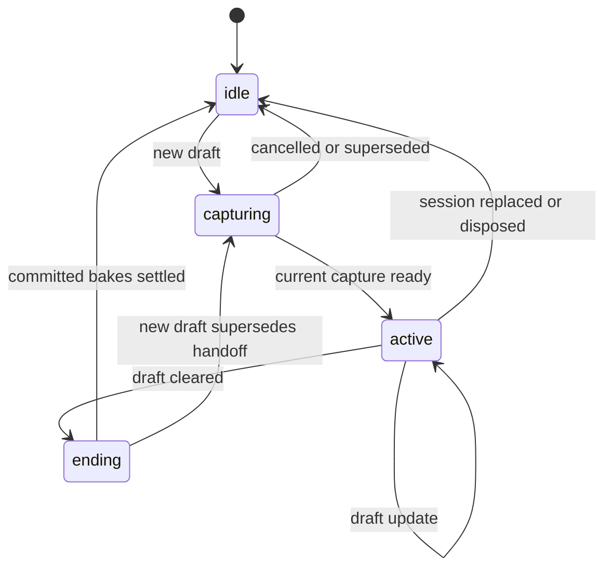

# Rendering pipeline

The editor has two display modes: committed layer surfaces while idle, and one composed scene canvas during a local draft. This design preserves layer-local erasing and a stable view while another participant edits the document.

The coordinator is `packages/splat/src/render/createRasterPipeline.ts`. `LayerStack` and `HotLayer` live in `packages/renderer-raster/src/`. Shape painting is delegated through `ShapeRendererRegistry` to `renderer-canvas` and the concrete renderers in `splat`.

## What each surface does

| Surface | Contents | Why it exists |
| --- | --- | --- |
| Drawing-layer tile canvases | Committed shapes for one drawing layer | Repaint dirty regions without replaying every layer across the viewport |
| Reference-image layer canvas | Committed image-layer presentation | Reference content has different update needs from shape tiles |
| Frozen `below`, `active`, `above` snapshots | Committed scene around the active drawing layer | The local stroke must not see a changing background |
| `HotLayer.activeScratch` | Active committed snapshot plus current draft | An eraser must erase only this drawing layer |
| Stage `hotCanvas` | Below + active scratch + above | One visible scene surface during drawing |
| Temporary snapshot/export canvases | Copies for capture or complete-document output | Different lifetimes and resolutions from interactive painting |

The stage still has a `hotOverlayCanvas`, but the current raster pipeline clears and hides it. It is not a second visible draft-rendering path.

## One stroke, from input to handoff

1. Input dispatch updates the active tool. The tool publishes a temporary shape and, for supported strokes, conservative dirty bounds.
2. The render loop invokes the pipeline. It consumes document diffs and dirty state even while a draft exists, keeping committed work moving.
3. On a new draft, the pipeline enters `capturing`. `LayerStack` waits for committed bakes and acquires the current prewarmed composite, or captures one if necessary.
4. If that session is still current, the pipeline installs the composite and enters `active`. Committed layer containers are hidden while the composed draft scene is displayed.
5. Each render restores the required active-scratch region from the frozen active snapshot, paints the current draft into it, and composes below/scratch/above into the hot canvas. The first frame and viewport changes require a full repaint; suitable tools supply dirty bounds for later frames.
6. Pointer-up commits the shape and clears the tool draft. The pipeline applies pending layer metadata and enters `ending`, retaining the completed visible frame while committed bakes drain.
7. Only after that handoff completes does it clear/hide the hot canvas and expose committed layers again.

This diagram describes renderer sessions, not the tool's document commit state. The pipeline observes drafts disappearing; cancellation must also drain any remote committed work before showing the final scene.

## Why erasing needs the scratch canvas

`destination-out` erases pixels already in the destination. Painting an eraser directly over a flattened background would erase reference art and lower layers too. Instead, restore the active drawing layer into scratch, erase there, then place that result between the untouched below/above snapshots.

Export and thumbnail rendering use `renderLayerStack` in `packages/renderer-canvas/src/document.ts`, which also isolates layers. Sharing the semantic rule matters more than forcing interactive and export paths to use the same canvas instances.

## Remote updates during drawing

The frozen display is intentional. Remote committed changes may arrive and update the store/tiles while the current stroke keeps its captured scene. Layer order, visibility and presentation changes are applied at handoff. There is no promise to show simultaneous in-progress strokes from other participants.

If the layer containing the local draft disappears, the unfinished stroke is cancelled. It must not be committed into a replacement layer. See [multiplayer lifecycle](multiplayer/lifecycle.md).

## Dirtying and replay are separate

`diffDocumentShapes` compares immutable document snapshots. `processApplyDocumentDiff` maps additions, removals and changes to old/new bounds and layers. Moving a shape must dirty its previous footprint as well as its new one. Z-order changes invalidate the affected layer; clear operations and uncertain/global changes take broader invalidation paths.

After choosing dirty tiles, the baker still needs an ordered set of shapes to replay. `tileShapeFilter.ts` conservatively filters shapes by transformed paint bounds, caches bounds by immutable shape identity, and preserves order. Unknown bounds remain candidates. A one-tile viewport bypasses the filter because there is no tile fan-out to eliminate.

This filter is a scan, not a spatial index. Dense overlapping shapes can all remain candidates. A clip rectangle alone would reduce raster work but would not avoid JavaScript geometry/path construction for rejected shapes.

## Why the apparently simpler alternatives are risky

- Displaying live committed layers under a draft removes the frozen-scene guarantee.
- Flattening all layers before applying an eraser changes layer semantics.
- Clearing the completed draft immediately on pointer-up can show a gap before tile baking finishes.
- Drawing only newly appended stroke segments can change opacity, joins and endpoint smoothing.
- Reusing a mutable layer canvas as an immutable snapshot allows later bakes to alter an active stroke's background.

Earlier browser experiments found poor animation cadence with multiple visible surfaces despite low measured JavaScript rendering time. The current single visible scene during drawing has experimental justification. Any topology change should repeat an equivalent browser experiment, not rely only on fewer source lines or microbenchmark CPU time.

Continue with [tool-specific paths](tool-rendering-paths.md), [ownership and invalidation](rendering-cache-ownership.md), and [validation](../guides/rendering-validation.md).
